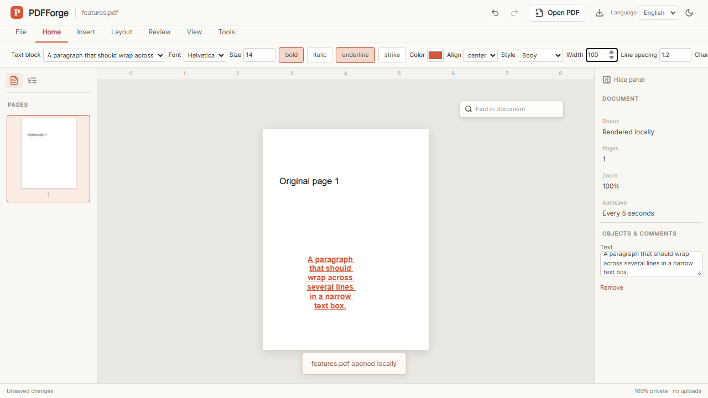

<div align="center">

# PDFForge

**A private workspace for your PDFs.**

Edit text, organize pages, review documents, and recognize scanned text directly in your browser.

[Get started](#getting-started) · [Features](#features) · [User guide](USER_GUIDE.md) · [Development](#development) · [Limitations](#important-limitations)

</div>



PDFForge brings PDF editing, annotation, page management, forms, and OCR into a responsive, ribbon-based workspace. Documents are processed on your device, with bundled fonts and OCR assets that support offline use.

**No account, API key, document uploads, or analytics.**

> **Project status:** Active development. Review the [important limitations](#important-limitations) before using exported documents in sensitive or production workflows.

## Features

| Capability | What you can do |
| --- | --- |
| Text and layout | Edit supported PDF text; format text with bundled or imported fonts; insert images, shapes, links, and tables. |
| Page management | Reorder, rotate, duplicate, delete, extract, merge, and split pages. |
| Navigation | Search document text and move through pages with thumbnails and bookmarks. |
| Review and annotation | Add highlights, comments, stamps, and measurements; manage supported annotations. |
| Forms | Create and fill supported AcroForms, and import field values from JSON or CSV. |
| Certificate signing | Sign locally with a P12/PFX certificate and inspect signed-byte integrity. |
| OCR | Recognize English and Spanish text, create searchable output, and review editable regions in embedded images. |
| Import and export | Convert supported documents and images, export edited PDFs, and download text or page images. |
| Workspace recovery | Undo and redo edits, and restore the last automatically saved workspace in the same browser. |

Desktop panels adapt to compact phone and tablet layouts. See the [user guide](USER_GUIDE.md) for individual tools and workflows.

## Getting started

### Requirements

- **Node.js 22.12 or newer** and npm.
- A modern browser. Automated browser tests use Chromium; broader browser and device validation is ongoing.

### Run locally

From your local copy of the repository:

```sh
npm ci
npm run dev
```

Open the local address printed by Vite. No backend or environment configuration is required.

### Edit your first document

1. Select **Open PDF** or drop a PDF onto the workspace.
2. Use the ribbon to edit text, insert content, annotate, or organize pages.
3. Use the download control to export the edited document.

Autosave supports workspace recovery. Export a copy when you want to keep or share your changes.

## Supported formats

| Operation | Formats |
| --- | --- |
| Open and edit | PDF |
| Import as a basic PDF | Images, TXT, Markdown, HTML, DOCX |
| Document and data export | PDF, TXT, Markdown, HTML, DOCX, CSV, XLSX |
| Page image export | PNG, JPEG, WebP |
| Form data | JSON export; JSON and CSV import |
| Signing certificate input | P12, PFX |

Conversions preserve supported content and edits, but may simplify complex layouts. Password-protected `.pdfg` packages are a PDFForge-specific format; they are not standard encrypted PDFs.

## Privacy and offline use

All document processing runs in the browser. PDF bytes, OCR input, edits, and signing data are handled locally; the application has no document upload endpoint or remote processing service.

- **Local recovery:** IndexedDB stores the opened document and supported workspace state. Autosave runs every five seconds while a document is open, and the footer reports save success or failure.
- **Bundled assets:** Fonts, PDF processing assets, and English/Spanish OCR resources are included locally. Certificate signing does not fetch certificate chains over the network.
- **Offline operation:** The production service worker caches application assets after an initial online load. Allow caching to finish before going offline. Dependency installation and the initial application load require a connection.

Recovery belongs to the browser profile and site origin where the document was opened. Clearing site data removes recovery records; changes since the last successful save can be lost. Export important work regularly.

## Important limitations

PDFForge does not yet support every PDF structure or editing workflow. Check exported results, particularly for complex layouts, forms, and signed documents.

| Area | Current behavior |
| --- | --- |
| Text editing | Normal edits use overlays. Covered source text can remain extractable in ordinary exports, and replacement text may not exactly match the original font or layout. |
| Redaction and sanitization | Dedicated secure exports rebuild pages as flattened images with current edits included. They remove searchable text, interactive forms, accessibility tags, bookmarks, and signatures. Scan-only text needs OCR before text-based redaction. |
| Signature verification | Local checks cover signed-byte integrity, coverage, and certificate dates. Issuer trust, revocation, trusted timestamps, and long-term validation require a separate trusted validation workflow. Editing a signed PDF can invalidate earlier signatures. |
| Password protection | Standard password-encrypted PDF export is unavailable. Protection uses PDFForge `.pdfg` packages. |
| Conversion and compatibility | Complex layouts, full structural reflow, and some advanced PDF features remain unsupported. Large scanned documents can consume substantial memory. Cross-browser and real-device validation is ongoing. |

**To remove sensitive content, use redaction or sanitization. Covering text in an ordinary edit does not securely remove the original content.**

## Development

### Commands

| Command | Description |
| --- | --- |
| `npm run dev` | Start the development server |
| `npm run build` | Check TypeScript and generate the production bundle |
| `npm run preview` | Serve the production bundle locally |
| `npm run lint` | Run ESLint |
| `npm run typecheck` | Check TypeScript types |
| `npm run test` | Run Vitest unit tests |
| `npm run test:e2e` | Run Playwright browser tests |
| `npm run test:all` | Run lint, type checks, unit tests, and browser tests |

### Validation

Install Chromium before your first browser-test run:

```sh
npx playwright install chromium
npm run test:all
npm run build
```

The browser suite also builds and launches a production preview to check offline recovery. Development mode does not provide the production offline deployment.

### Production preview

```sh
npm run build
npm run preview
```

The build output is written to `dist/`. Serve the production bundle over HTTPS or localhost to enable the service worker.

### Architecture

PDFForge uses **React 18**, **strict TypeScript**, and **Vite**. PDF rendering uses **pdf.js**, editing uses **pdf-lib**, and OCR uses **Tesseract**. **Zustand** and **Immer** manage application state and undo/redo history; **IndexedDB** provides local recovery.

```text
src/        Application components, processing modules, state, and unit tests
public/     Bundled fonts, offline assets, and service worker
scripts/    Local asset tooling and fixture generation
fixtures/   Sample documents for development and testing
e2e/        Playwright browser tests
docs/       Screenshots and supporting documentation
```

## Contributing

Keep document processing browser-local, use strict TypeScript, and include tests for user-facing features. Run the full validation suite before milestone commits and describe material assumptions in your change description.

Read [CONTRIBUTING.md](CONTRIBUTING.md) for engineering guidance and [USER_GUIDE.md](USER_GUIDE.md) for application workflows.
