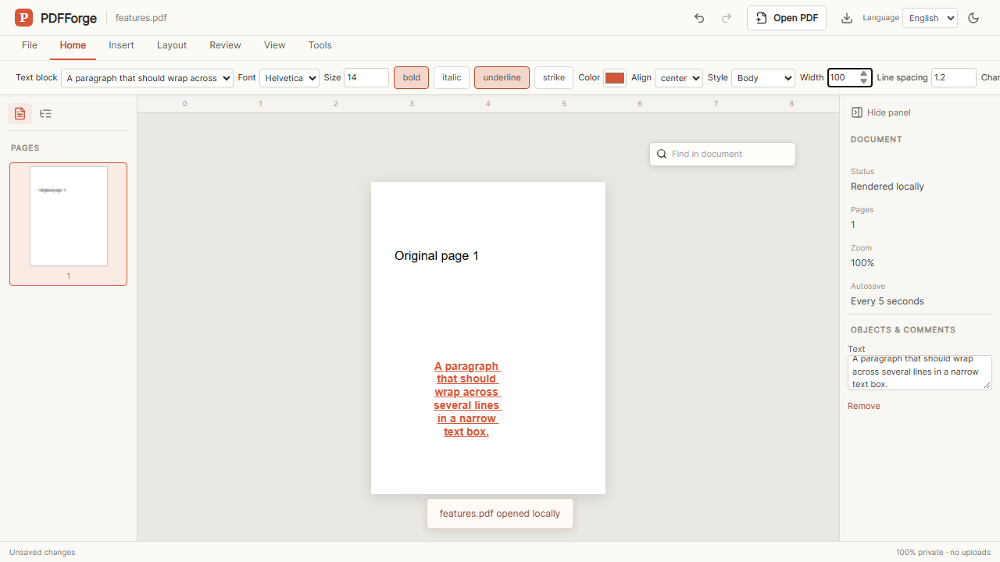

# Using PDFForge

PDFForge processes documents in your browser. The application bundles its PDF renderer, OCR workers, language models, and Unicode font. Use the latest supported Node 22 release for development.

## Open, recover, and export

1. Run `npm install` and `npm run dev`, then open the URL printed by Vite.
2. Choose **Open PDF** or drop a PDF onto the document canvas.
3. Use the thumbnails or outline to navigate. View changes zoom from 10 to 500 percent.
4. The footer changes to **Saved locally** after the five-second recovery save completes. Reload restores the saved bytes, edits, and page settings.
5. Choose the download icon in the title bar to export an edited PDF.

The current browser profile owns the recovery data. Clearing its site storage removes that recovery data. Unsaved edits inside the five-second interval can be lost on a crash.

Opening validates the PDF before replacing your workspace. A damaged or password-protected file reports an error and keeps your current edits. Unlock password-protected PDFs before opening them.

Find in document searches the current page sequence, including supported replacement text, inserted text, links, tables, and detected field values. Covered source text is excluded from this search. Matching ignores case; replace, regex, and result cycling remain unfinished.

## Edit text and formatting

Double-click document text to edit a geometry-grouped paragraph. Click outside the editor to commit it. The object sidebar also edits text directly and supports multiline values.

Home selects the text block to format. Change font family, size, bold, italic, underline, strikeout, color, alignment, style, block width, line spacing, character spacing, list style, or indentation. Scroll the ribbon horizontally to reach controls toward its end. Clear formatting resets the supported block properties.

Reflow wraps within the block width. Inserted blocks grow upward from their bottom position. Geometry-based paragraph grouping can need correction in complex columns. Normal edits cover source content visually, while the original source layer remains in an ordinary edited export.

### Match similar text

Select a text block in Home and choose **Smart text match**. The button shows the number of matching blocks across current pages. Font family, bold/italic, and size within 5% or 0.5 points determine the group. Choose formatting or apply a saved style to update the group together. Undo reverses each group formatting operation in one step. Click the matched-block button to leave the group.

Matching uses the supported fallback font families and groups compatible source lines into paragraphs. Source ink colors and embedded-font identity can change during replacement. Blocks whose covers would overlap unmatched text are skipped. Angled source text and vertical writing require manual editing. Changing text, selection, page order, history, or ribbon tabs ends the group.

### Save styles and snippets

Choose **Home → Styles & snippets**. In **Styles**, enter a name, choose Paragraph or Character, and select **Save selected style**. Paragraph presets capture font and paragraph settings. Character presets apply font settings to entire blocks and preserve alignment, indentation, lists, and line spacing. Apply a saved style to the selected block or active matched group.

In **Snippets**, enter a name and text, or choose **Use selected text**. **Save snippet** stores its text and current formatting. Set X, Y, and Width in PDF points measured from the bottom left, then choose **Insert** beside a saved snippet. It inserts on the current page and supports workspace undo, recovery, and export.

The library is shared across files in this browser profile and site. Saves and deletions persist immediately. Each save creates a separate record. Clearing site storage removes the library along with recovery data. Signature snippets store reusable text.

## Insert objects and annotations

Insert adds text, images, rectangles, tables, links, form fields, and typed signature lines. Objects use default geometry, with field geometry available in the form properties. The sidebar edits supported values and removes objects.

Review adds highlights, notes, predefined stamps, and linear measurements. Supported annotations include PDF appearance streams. PDFForge XFDF import/export exchanges its own annotation XML schema. Other vendor schemas require additional interoperability work.

## Text flow, columns, and drop caps

Choose **Layout → Text flow & columns**. **Add text box** creates a box on the current page. Select a box to edit its text, position, width, height, column count/gap, and drop cap. Positions use PDF points from the bottom left. Two/three-column text balances within the frame height.

Create another box, select the first box, choose the continuation target, and select **Link text boxes**. Targets can be on another page. A story combines each box's stored text in chain order. Edit a box's contribution in the dialog or sidebar. **Unlink continuation** retains the original contributions. Removing a page reflows a story through its surviving frames. Removing a box deletes its contribution.

A red plus marks overflow, and Layout reports how much text remains. Enlarge the frames or add a continuation until it fits to export the full story. Unicode fallback widths are approximate. Moving replacement text keeps its source cover at the original location.

## Shapes, connectors, and equations

Choose **Layout → Shapes & connectors** to add process rectangles, decision diamonds, ellipses, or oval terminators. Set a label, color, position, and size. Choose two shapes on the current page and select **Connect shapes**. Drag shapes or use arrow keys to move them. Shift increases keyboard movement to ten points. Connectors follow both shapes through movement, zoom, page rotation, undo, and PDF export. Deleting a shape also deletes its connectors.

Choose **Layout → Equation editor** to enter supported LaTeX and preview it. **Insert equation** adds it on the current page. Select an existing equation to change its input, font size, color, or position, then choose **Update selected equation**. Equations export as vector font glyphs and rules.

Examples include `x^2 + y_1`, `\frac{a}{b}`, `\sqrt{x}`, and `\sum_{i=1}^{n} i`. Fractions, roots, scripts, Greek letters, common operators/functions, and plain text are supported. Matrices, custom macros, packages, automatic delimiter sizing, and full TeX typography remain pending. Invalid or unsupported input shows an error before insertion.

## Image editing

Insert a PNG or JPEG, then choose **Layout → Image tools**. Select the image and set crop percentages, clockwise quarter-turn rotation, mask, brightness, and contrast. **Remove background** clears pixels connected to the image edges that match the selected color and tolerance. It works best with uniform backgrounds.

Choose **Preview image edits**, then **Apply image edits** to save the result as a transparent PNG in the document. Crop and rotation update its display dimensions. Undo restores the previous image in the current session. Edited images recover locally and export with transparency. Editing supports up to 16 million pixels per image.

## Tracked text changes

Choose **Review → Tracked changes**, enable tracking, and enter an author name. Edits to one block accumulate into one pending change until reviewed, retaining its original/current text, contributing authors, and timestamps. Pending records keep following further edits until accepted or rejected.

The review dialog filters pending, accepted, rejected, or all changes. **Go to changed text** selects its block/page. **Accept change** retains the current text. **Reject change** restores the original text or removes a tracked insertion/source replacement. Review actions support Undo and Redo. Settings and review records recover with the workspace. PDF export uses the current text, and review metadata stays in the local workspace.

Tracking covers whole-block text. Inline revision markup, formatting/object changes, authenticated author identities, and review-data interchange remain pending.

## Manage pages

Tools moves the selected page up or down, rotates it, deletes it, duplicates it, or splits it into a separate PDF. Merge PDFs combines selected files locally. Header/footer text accepts `{page}`, and Tools also sets watermark and Bates numbering.

Merged files retain supported form fields. If inputs use the same field names, PDFForge renames the colliding form trees so their values remain independent. Open the downloaded merge and choose Detect form fields to fill them.

Ordinary page plans retain source metadata, bookmarks, names, page labels, and form registrations. Deleted-page destinations point to the first surviving page. Duplicated pages share the PDFForge source-page edit layer and rotation. Existing copied form fields receive independent registrations.

## Fill and create forms

Tools, then Detect form fields loads supported existing AcroForms into the sidebar. Insert creates text, checkbox, radio, dropdown, list, date, reset-button, and visible signature fields.

The sidebar sets values, choice options, required/read-only flags, multiline text, maximum character count, and new-field geometry. Date fields store an ISO date. Reset buttons reset fields in PDF readers that support standard ResetForm actions.

Select Choose to clear a radio, dropdown, or list selection. Clear Maximum characters to remove an existing text-field limit.

Tools exports form values as JSON. Import form data accepts a JSON object or the first data row of a CSV. Keys use the existing PDF field name or the new field label. Duplicate labels receive an ID suffix in exported data so both values survive.

Mail merge CSV replaces `{{column}}` tokens in text, links, and form values and downloads one PDF per row. Quoted multiline cells and escaped quotes are supported. Cell edges are trimmed.

## Sign with a certificate

Open Tools, then Certificate signing. Select a P12/PFX certificate, enter its password and a reason, and choose Sign and download. The generated PDF includes the current edits and a CMS/PAdES B-B signature.

Verification reports signed-byte integrity, coverage, and certificate validity dates. Issuer trust and revocation need your trusted reader or trust store. The app keeps certificate material in session memory and clears the password after a successful signature. Additional signatures on an unchanged file use its original bytes. Changes to signed content can invalidate earlier signatures.

## Recognize scanned pages

Tools, then Offline OCR supports English, Spanish, and a combined mode. Recognize document adds a searchable text layer with local worker progress. Cancel OCR stops the operation and discards partial results.

If you edit the document while recognition runs, PDFForge preserves those edits and discards the stale OCR result. Run recognition again to include the updated content.

Recognition depends on scan quality. Inspect the recognized text before relying on it. Already searchable pages can receive duplicate text when OCR is applied again. The first offline installation caches the bundled engines and models and therefore downloads more application assets than the basic editor.

## Redact and sanitize current edits

Enter exact text in Tools and choose Export redacted copy. Matching covers whole intersecting text runs. Scan-only pages need OCR before text matching. Sanitize PDF uses the same rendered-copy pipeline without text masks.

Both operations export the current edits, form values, annotations, marks, rotations, and page sequence first. They then build fresh page images at twice point resolution and verify the result has no extractable text. Source metadata, scripts, attachments, and hidden text are excluded by construction.

Secure output is flattened. It loses searchable text, interactive fields, tags, bookmarks, vector fidelity, and certificate signatures. Normal edited export preserves the supported editable structures. Review the secure copy visually before distribution.

## Convert and import

Tools exports TXT, HTML, Markdown, DOCX, PNG, JPEG, WebP, table CSV/XLSX, and a ZIP of all page PNGs. Export print PDF flattens form appearances and sets viewer print scaling to None. Text/document and image exports include the supported current edits and page plan.

Import document accepts PNG, JPEG, WebP, TXT, Markdown, HTML, and DOCX. Document imports preserve readable text with basic layout. HTML retains paragraph, line-break, and table-cell text boundaries. Original complex layouts, embedded images in DOCX/HTML, and mixed typography need further conversion work. Table detection is heuristic and can misclassify prose.

Optimize PDF repacks the current edited PDF and reports its size change against that edited export. Compare PDF checks current page text against another local PDF, including word order and page count. It ignores case and punctuation and does not compare visual layout.

## Samples and validation

The fixtures directory contains `text.pdf`, `scanned.pdf`, `form.pdf`, `multi-column.pdf`, and `large.pdf`. The large sample has 300 pages. Regenerate samples with `node scripts/generate-fixtures.mjs`.

Run `npm run test:all` for lint, strict type checks, unit tests, and browser workflows. Run `npm run build` for the production bundle. The browser suite also builds a production preview and checks offline recovery. Broader real-world and cross-browser acceptance limits are listed in [KNOWN_LIMITS.md](KNOWN_LIMITS.md).
